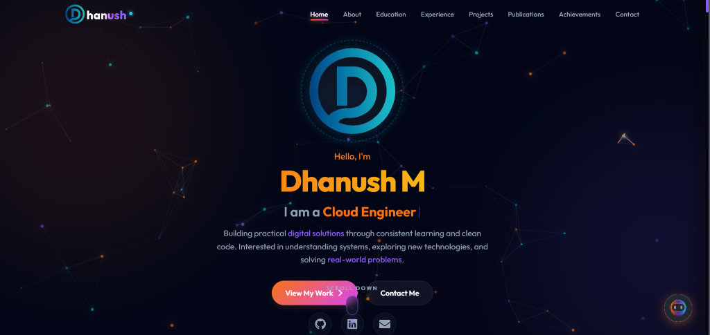
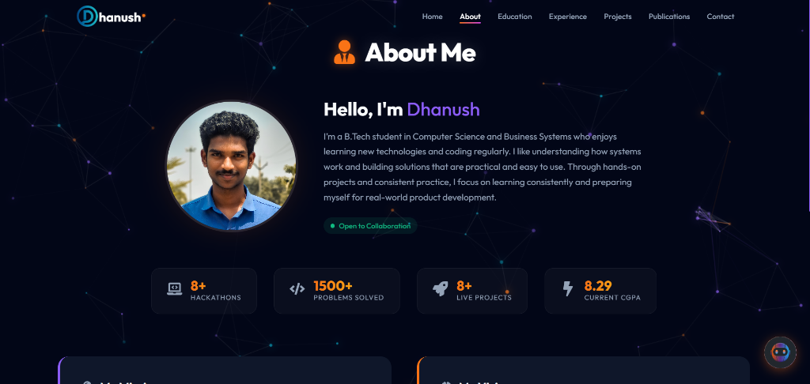
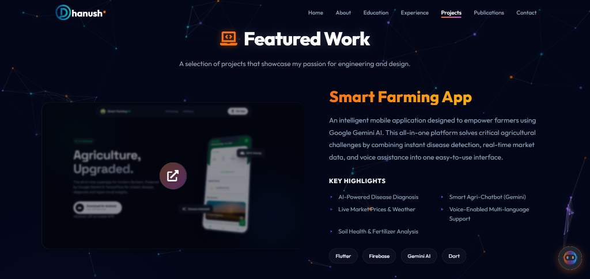
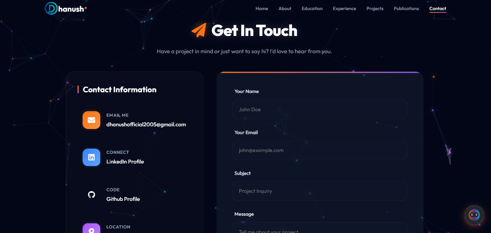

# Dhanush Portfolio


🌐 **Live Website:** [https://dhanush-m.web.app/](https://dhanush-m.web.app/)

A premium, high-performance single-page portfolio website designed to showcase skills, projects, and professional experience. Built with a focus on smooth animations, responsive design, and modern web best practices.



## 🌐 Live Demo

Check out the live interactive website:  
👉 **[https://dhanush-m.web.app/](https://dhanush-m.web.app/)**

## 📑 Table of Contents

- [Live Demo](#-live-demo)
- [Features](#-features)
- [Screenshots](#-screenshots)
- [Tech Stack](#-tech-stack)
- [Project Structure](#-project-structure)
- [Getting Started](#-getting-started)
- [Configuration](#️-configuration)
- [Deployment](#-deployment)
- [Contributing](#-contributing)
- [Contact](#-contact)

## 🚀 Features

-   **immersive UI/UX**: Custom cursor, glassmorphism effects, and smooth reveal animations.
-   **📱 Fully Responsive**: Flawless experience across all devices (Mobile, Tablet, Desktop).
-   **⚡ High Performance**: Powered by Vite for lightning-fast HMR and optimized builds.
-   **🎨 Dynamic Theming**: Sophisticated dark theme with vibrant accent colors.
-   **📧 Smart Contact**: Integrated EmailJS for direct messaging and Firebase for data backup.
-   **🤖 AI Chatbot**: A custom-built chatbot interface to answer visitor queries (simulated).
-   **💼 Interactive Resume**: dedicated sections for Experience, Education, and Skills.

## 📸 Screenshots

| **Home** | **About** |
| :---: | :---: |
|  |  |

| **Projects** | **Contact** |
| :---: | :---: |
|  |  |

## 🛠 Tech Stack

**Frontend**
-   [React](https://reactjs.org/) - UI Library
-   [Vite](https://vitejs.dev/) - Build Tool
-   [Framer Motion](https://www.framer.com/motion/) - Animations
-   [React Router](https://reactrouter.com/) - Navigation
-   [React Icons](https://react-icons.github.io/react-icons/) - Iconography

**Backend & Services**
-   [Firebase](https://firebase.google.com/) - NoSQL Database (Firestore)
-   [EmailJS](https://www.emailjs.com/) - Email/Form Handling

## 📂 Project Structure

```bash
portfolio/
├── public/              # Static assets (favicons, manifest, screenshots)
├── src/
│   ├── assets/          # Images, logos, and global static files
│   ├── components/      # Reusable UI components (Navbar, Chatbot, Cards)
│   ├── context/         # Global state management (Theme, User data)
│   ├── hooks/           # Custom React hooks (useScrollReveal)
│   ├── pages/           # Main route pages (Home, About, Projects)
│   ├── firebase.js      # Firebase configuration and initialization
│   ├── App.jsx          # Main application component & routing layout
│   └── main.jsx         # Application entry point
├── .env                 # Environment variables (GitIgnored)
└── package.json         # Project dependencies and scripts
```

## 🏁 Getting Started

Follow these steps to set up the project locally.

### Prerequisites

-   **Node.js**: v16.0.0 or higher
-   **npm** or **yarn**

### Installation

1.  **Clone the repository**
    ```bash
    git clone https://github.com/Dhanush-M2005/Dhanush-Portfolio.git
    cd Dhanush-Portfolio/portfolio
    ```

2.  **Install dependencies**
    ```bash
    npm install
    # or
    yarn install
    ```

## ⚙️ Configuration

This project requires environment variables for EmailJS and Firebase. Create a `.env` file in the `portfolio` root directory:

```env
# EmailJS Configuration
VITE_EMAILJS_SERVICE_ID=your_service_id
VITE_EMAILJS_TEMPLATE_ID=your_template_id
VITE_EMAILJS_PUBLIC_KEY=your_public_key

# Firebase Configuration (If using backend features)
VITE_FIREBASE_API_KEY=your_api_key
VITE_FIREBASE_AUTH_DOMAIN=your_project.firebaseapp.com
VITE_FIREBASE_PROJECT_ID=your_project_id
VITE_FIREBASE_STORAGE_BUCKET=your_project.appspot.com
VITE_FIREBASE_MESSAGING_SENDER_ID=your_sender_id
VITE_FIREBASE_APP_ID=your_app_id
```

3.  **Run the development server**
    ```bash
    npm run dev
    ```

## 🚀 Deployment

The project is deployed on **Firebase Hosting**.

**Build & Deploy for production:**
```bash
npm run build
firebase deploy --only hosting
```

Live Website: **[https://dhanush-m.web.app/](https://dhanush-m.web.app/)**

## 🤝 Contributing

Contributions are welcome! If you'd like to improve this portfolio template:

1.  Fork the repository.
2.  Create a new branch (`git checkout -b feature/AmazingFeature`).
3.  Commit your changes (`git commit -m 'Add some AmazingFeature'`).
4.  Push to the branch (`git push origin feature/AmazingFeature`).
5.  Open a Pull Request.

## 📬 Contact

**Dhanush M** - App Developer & Tech Enthusiast

-   [LinkedIn](https://www.linkedin.com/in/dhanushm2005/)
-   [GitHub](https://github.com/Dhanush-M2005)
-   [Email](mailto:dhanushofficial2005@gmail.com)

---
*Built with ❤️ by Dhanush M*
